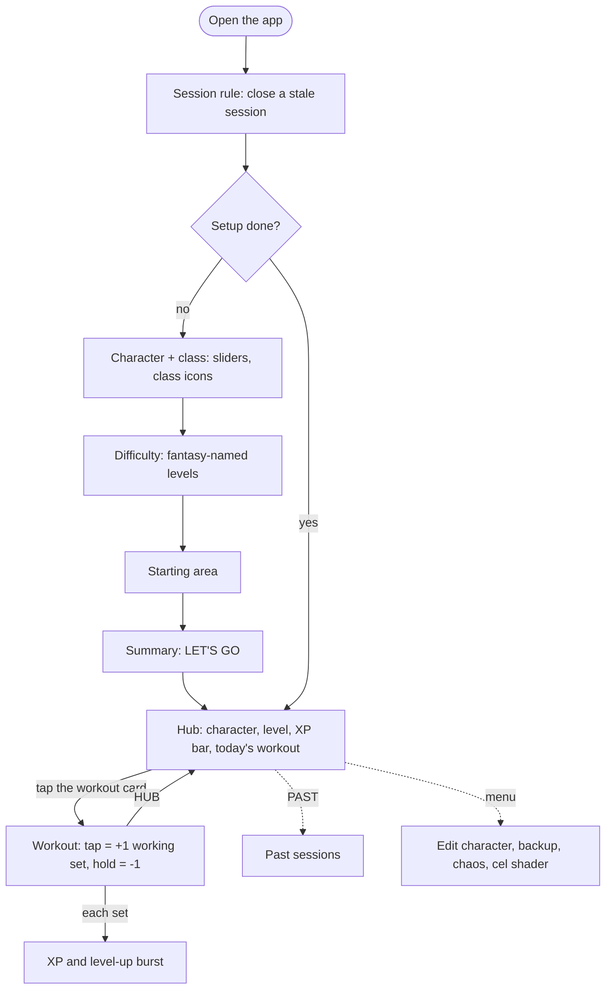

# PUMPLEX app flow

Date: 21 November 2026. Status: draft v3 (built on branch `claude/game-flow-2dbf96`).
Read with [app-brief.md](app-brief.md), `pumplex.drawio` and `docs/moodboard/`.

Status key: **exists** = in the app now. **later** = waits for the design team or the rules table.

## 1. Overview

The app has 2 parts:

1. **Initial setup** (first launch only): character, class, difficulty, starting area.
2. **Play** (any time): open the workout, count the working sets, get XP.

There is no calendar, no 7-day plan, no START TRAINING clock and no I WORKED button.
The user opens the app when they want, like a video game.

The whole app is **one screen**. Views are scenes of that screen. A change of view is a
camera move (zoom in, zoom out or slide), and the one character glides to its new place.
The app never pushes a new route for a view, so it never flashes a blank screen.

## 2. Screens (scenes)

| # | Scene | Status | Purpose |
|---|---|---|---|
| 1 | Character + class | exists | WoW-style: the character large in the centre on a pedestal. Sex toggle, 🎲 random, class icons row, sliders for height, muscle and fat %. Changes live. |
| 2 | Difficulty | exists | 12 fantasy-named levels, beginner to years of lifting. Shows the XP multiplier. |
| 3 | Starting area | exists | 2 placeholder areas. Real areas come from the design team. |
| 4 | Summary | exists | Class, gear, difficulty, area. Tap a row to change it. LET'S GO (or SAVE when editing). |
| 5 | Hub | exists | The character, the level and XP bar, today's workout card. |
| 6 | Workout | exists | One card per exercise. Tap adds a working set, long-press removes one. Tally marks. |
| 7 | Reward | exists | XP shows on each card. A level-up burst when you reach a new level. |
| 8 | Past sessions | exists | Game sessions (sets per exercise, time, XP) and the old saves (beta XP). |
| 9 | Menu | exists | Edit character, save / restore backup, chaos mode, cel shader. |

Removed: the preloader, START TRAINING and its clock, I WORKED / I RESTED and UNDO,
the 7-day pattern, rest days, rest-day stats and the preview pages.

## 3. Initial setup

Show it on the first launch, and again from the menu (EDIT CHARACTER).

1. **Character + class.**
   - Pick male or female. Sliders: height, muscle size, fat %. The user never types a weight or a height.
   - Sprites: mood board body sliders (fat 0/50/100 × muscle 0/50/100 per sex). The app shows the
     nearest frame for in-between values and stretches the sprite vertically for height.
     Nearest-neighbour scaling only.
   - "What do you train with?" One class per equipment type (working names in `lib/game/content.dart`):

     | Pick | Class (working name) |
     |---|---|
     | Nothing | Speedster: cardio, push-ups, burpees, sprints, jumps |
     | A basic home gym | Rogue: floor work, some cardio, some weights |
     | A lot of free weights | Warrior: burly strongman |
     | A lot of machines | Mage: stringy and strong |

     Until the class outfits are drawn, the class shows as the pedestal colour, a prop icon and a name tag.
2. **Difficulty.** 12 levels with our own fantasy names (placeholders, `lib/game/content.dart`).
3. **Starting area.** Placeholders. Later: background, palette and set-mark style.
4. **Summary.** LET'S GO saves the profile. If the phone has old sessions, the welcome burst shows the beta XP.

## 4. Play

### 4.1 Hub

- The character, the class and difficulty name tag, the level and the XP bar.
- Today's workout card: the class exercises, with tally marks for the sets done in the open session.
  Tap the card: the camera zooms into the workout.
- ◀ PAST (top left) slides to the past sessions.

### 4.2 Workout

- One card per exercise (placeholder list per class, `lib/game/content.dart`).
- Tap a card: one more working set. Long-press: one set less (for a wrong tap).
- The mark is a plain tally mark for now. Themed marks per starting area (shells, wall scratches) come later.
- On the first workout a hint says: working sets only, warm-up sets do not count.
- ◀ HUB (or Android back) goes back to the hub. The session stays open.

### 4.3 XP and level

- XP = working sets × XP per set × difficulty multiplier.
- Old sessions from `sessions_v2` give a fixed XP each (beta).
- Every number is in `lib/game/rules.dart`: XP per set, multipliers, level curve, XP per old session.

### 4.4 The session rule

There is no I WORKED button, so the app decides when a session starts and ends:

1. A session **starts** with its first working-set mark.
2. It **closes** when the app is opened (cold start, or back from the background) on a
   **later calendar day** than its last mark.
3. It also **closes** after **3 hours with no new mark** (`sessionTimeout` in `lib/game/rules.dart`).
   The app checks this when it opens and before each new mark.
4. A mark while the app stays open after midnight does not split the workout (only rule 3 applies then).
5. A long-press that removes the last set of a session removes the session (it did not happen).
6. A closed session never opens again. The next mark starts a new one.

When the app opens and closes a session, a message says: "LAST SESSION BANKED: N SETS · +X XP".

## 5. History

- Game sessions: date, sets, time from the first to the last mark, class, XP, tally per exercise.
  The open session shows first, marked NOW.
- Old saves (from the old app): date, worked or rested, time if the old clock was used.

## 6. Special cases

| Case | What the app does |
|---|---|
| First launch with old data (sessions exist) | Run the initial setup. Old sessions become XP (beta). |
| App closed during a workout | The marks are saved. Open the app to continue (the session rule applies). |
| Wrong mark | Long-press the exercise card. |
| Restore a backup | Replace all data. Old version-2 backups still load; they have no game data, so the setup runs again. |

## 7. Data

The temporary data model is in `lib/game/model.dart` (notes at the top of the file).
The real schema is designed in a separate document.

- Profile (`game_profile_v1`): character (sex, height, muscle, fat 0–100), class id, difficulty id, area id.
- Sessions (`game_sessions_v1`, open one in `game_open_v1`): first and last mark time, class id,
  difficulty id, working sets per exercise id.
- XP and level are not stored. They are computed.
- Old keys `sessions_v2`, `logs_v2`, `swaps_v2` are never changed by the game and stay in backups.
