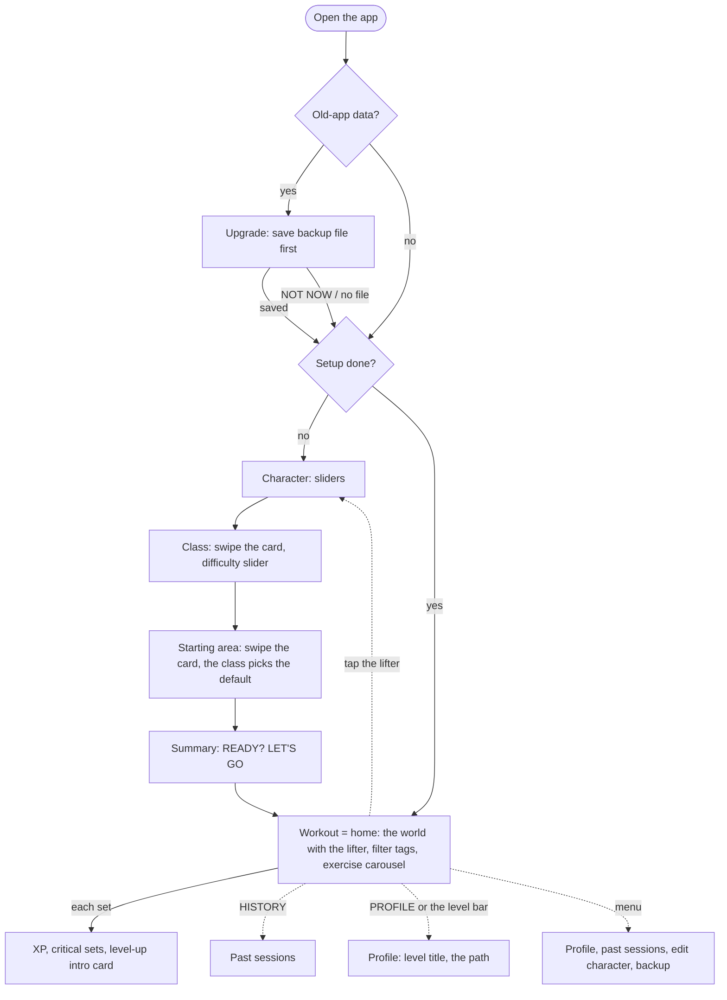

# PUMPLEX app flow

Date: 22 November 2026. Status: draft v10 (matches the code on `main`, with D50–D54).
Read with [decisions.md](decisions.md) (it wins), [app-brief.md](app-brief.md), [data-schema.md](data-schema.md),
`pumplex.drawio` and [docs/moodboard/](moodboard/README.md).

Status key: **exists** = in the app now. **later** = waits for the design team or the rules table.

## 1. Overview

The app has 3 parts:

1. **One-time upgrade** (only on a phone with old-app data): save a backup file, then turn the old
   sessions into XP and delete the old kg / reps data.
2. **Initial setup** (first launch): character, class, difficulty, starting area.
3. **Play** (any time): open the workout, count the working sets, get XP and levels.

There is no calendar plan, no START TRAINING clock and no I WORKED button.
The user opens the app when they want, like a video game.

The whole app is **one screen**. Views are scenes of that screen. A change of view is a
camera move (zoom in, zoom out or slide), and the one character glides to its new place.
The app never pushes a new route for a view, so it never flashes a blank screen.

## 2. Screens (scenes)

| # | Scene | Status | Purpose |
|---|---|---|---|
| 0 | Upgrade | exists | Only with old-app data. SAVE BACKUP & UPGRADE, or NOT NOW. |
| 1 | Character | exists | WoW-style: the character large in the centre on a pedestal. Sex toggle; sliders HEIGHT (1.50–2.00 m), WEIGHT (50–200 kg) and MUSCLE, with the current height and weight on the right. A lime box marks the head: tap it for skin, hair and facial hair (D45). Changes live. No ⋮ menu button on the first setup. The sprite comes from the 5×5 body atlas. |
| 2 | Class select | exists | One big card (lifter, class name, equipment, loadout, 3 tags, description). Swipe to change the class, both ways, round and round; dots under the card (D46). Under them the DIFFICULTY slider, the mode name on the right (D47). No titles in the view. NEXT: STARTING AREA. |
| 3 | Difficulty | removed | Now the slider on the class step (D47). |
| 4 | Starting area | exists | A swipe card like the class card: the area scene with the lifter in it, the name, the line, what you hit, "YOUR PATH'S HOME" on the default; dots under it (D47). The class picks the default area. |
| 5 | Summary | exists | Class, equipment, difficulty, area. Tap a row to change it. LET'S GO (or SAVE when editing). |
| 6 | Hub | removed | No hub (D49): the app opens on the workout. The level and XP bar is in the PUMPLEX bar there; tap the lifter in the world for the body sliders. |
| 7 | Workout | exists | The home screen (D49). One card (D48): the world (area scene with the lifter) on top, filter tags (D51, D53), an exercise carousel under it over every exercise the filters show (D50; swipe both ways, round and round; a counter; a star button). No targets (D52). Tap the object = +1 set to the exercise shown, hold = −1. Area marks stay in the world. Bottom bar, HUB lit (D44). |
| 8 | Reward | exists | XP on the active exercise line. CRITICAL SET message. Freeze-frame intro card for level-ups. No achievement burst (D35). Not a separate screen. |
| 9 | Past sessions | exists | Training days (sets per exercise, time, class, area, XP) and old saves. Bottom bar (D44). |
| 10 | Gear | removed | No gear (D38). |
| 11 | Menu | exists | Full screen: YOU (profile, past sessions, edit character), GAINS INSURANCE (save / restore backup). No chaos mode, cel shader or sound (D39–D41). Opens from ⋮ on every view. |
| 12 | Profile | exists | level and level title, XP bar, the path (class, difficulty, world; tap one to change it), PAST SESSIONS. No milestones (D35). Opens from PROFILE or the level bar on the hub. Tap the lifter to change the body. Bottom bar (D44). |

Removed: the preloader, START TRAINING and its clock, I WORKED / I RESTED and UNDO,
the 7-day pattern, rest days, rest-day stats and the preview pages.
Removed on 22 Nov 2026: the workout tools SWAP, FIRST, SKIP, REMOVE and the ADD card (D32),
the streak and the hub's "This week" card (D34), and the achievements and milestones (D35).

## 3. Initial setup

Show it on the first launch. The body sliders open again from the workout (tap the lifter) and
the whole setup from the menu (EDIT CHARACTER).

1. **Character.**
   - Pick male or female. Sliders (D45):
     - HEIGHT, 1.50 M to 2.00 M. Only the current value shows, above the slider on the right.
     - WEIGHT, 50 KG to 200 KG. Only the current value shows, the same way. It picks the fat column of the atlas.
     - MUSCLE, with no value and no end labels.
     No hint text: a lime outline box around the head shows it can be tapped.
     The user never types a weight or a height. The values are saved as 0–100 (`height`, `fat`, `muscle`).
   - No random button. No ⋮ menu button on the first setup (it shows again when editing later).
   - **Tap the head** (inside the lime box): the camera zooms onto the head and the panel shows SKIN (light, deep),
     HAIR (brown, blonde) and FACIAL HAIR (none, beard; both bodies). DONE (or a tap on the head,
     or Android back) zooms out. The looks come from `tools/moodboard/looks.mjs`
     (`assets/body/looks/`): skin and hair are recolours of the body atlas, the beard is an overlay.
   - Sprites: the design team's 5×5 body atlas (`assets/body/body_atlas.png`, a copy of
     `docs/moodboard/creator/body_atlas.png`). Fat and muscle each have stops at 0/25/50/75/100,
     per sex. The app shows the nearest cell for in-between values.
   - The HEIGHT slider scales the sprite evenly, 0.86× to 1.14× (D11, D45). Nearest-neighbour scaling only.
2. **Class select and difficulty** (design: `docs/moodboard/README.md` "Class select", D46, D47).
   - No step kicker, title or subtitle in the view: the PUMPLEX bar says "CLASS · STEP 2 OF 4".
   - One big card fills the top (D46): the user's lifter (from step 1) on top, then the class name
     in its colour, the equipment, the loadout, 3 tags and the description. No stat table. The
     card's hard shadow takes the class colour. The lifter gets the biggest whole-number scale that
     leaves room for the texts; the texts scroll on a short phone.
   - Swipe the card left for the next class, right for the one before, round and round. Dots under
     the card show the class; tap a dot to jump. No class buttons and no freeze-frame card here.
     One class per equipment type.
     Proposed names, kept in `lib/game/content.dart`. The ids are the design ids (D31) and never change:

     | Equipment | Class | Id | Colour |
     |---|---|---|---|
     | No equipment | Scrapper | `scrapper` | orange |
     | Basic home gym | Bargain Bruiser | `bruiser` | sky |
     | Lots of free weights | Plate Paladin | `paladin` | lime |
     | Lots of machines | Cablemancer | `cablemancer` | violet |

   - **Difficulty** (D47): a slider under the dots, 6 stops, the mode name above it on the right in
     its rarity colour. No ladder and no freeze-frame card. Names in `lib/game/content.dart`:
     Sofa, Warm-up, Sweat, Pain, Brutal, Nightmare Mode (D28). Ids: `sofa`, `warmup`, `sweat`,
     `pain`, `brutal`, `nightmare`. The numbers per mode are in `lib/game/rules.dart` (XP) and `lib/game/exercises.dart` (levels):

     | Mode | Exercise levels shown (D51) | XP multiplier |
     |---|---|---|
     | Sofa | beginner | 1.0 |
     | Warm-up | beginner | 1.2 |
     | Sweat | beginner, intermediate | 1.4 |
     | Pain | beginner, intermediate | 1.6 |
     | Brutal | all | 1.8 |
     | Nightmare | all | 2.0 |

   - NEXT: STARTING AREA.
   - The preview shows the body the user made in step 1, in the class outfit (D25).
3. **Starting area** (design: `docs/moodboard/README.md` "Starting areas", D47).
   - No titles in the view: the PUMPLEX bar says "STARTING AREA · STEP 3 OF 4".
   - 5 areas. Each area has an object to hit, a set-mark style and a stamp for every 5th set:

     | Area | Id | Object | Set marks | Stamp | Default for |
     |---|---|---|---|---|---|
     | Riptide Shore | `riptide` | treasure chest | shells | PEARL! | — |
     | Gainsgard Keep | `gainsgard` | wall | tally marks | SLASHED! | Plate Paladin |
     | Rustbelt Flats | `rustbelt` | barrel | spray-painted Xs | TAGGED! | Scrapper |
     | Arcade Underpass | `arcade` | punch machine | tickets | COMBO! | Bargain Bruiser |
     | Frostbite Summit | `frostbite` | ice block | flags up a slope | SUMMIT! | Cablemancer |

   - The ids are the design ids (D36). The id is also the design's folder name in
     `assets/areas/`. Old saved ids (`beach`, `castle`, `summit`) migrate once
     ([data-schema.md](data-schema.md) §5.3).
   - The class picks the default area until the user picks one. The user can choose any area.
   - One swipe card like the class card: the area's scene edge to edge at a whole-number scale
     (the sides may be cut a little, never stretched) with the lifter standing in it, then the name,
     the line, what you hit (e.g. SCRATCH THE WALL) and "YOUR PATH'S HOME" on the default area.
     Swipe both ways, round and round; dots under the card.
   - The scenes are the design team's PNG layers (`assets/areas/<area id>/`). `tools/app/area_art.mjs`
     turns their `anim.json` files into `lib/game/area_art.dart`.
   - NEXT: READY?.
4. **Summary** ("STEP 4 OF 4 · READY?"). Its DIFFICULTY row opens the class step. LET'S GO saves the profile. If old sessions were upgraded, the welcome burst shows their XP.

## 4. Play

### 4.1 Hub (removed)

There is no hub screen (D49). The app opens on the workout (§4.2), and HUB in the bottom bar goes there.

- **Level and XP bar:** in the PUMPLEX bar on the workout. Tap it to open the profile.
- **Tap the lifter** in the world to change the body sliders at any time. Each saved change is kept
  in a history (for charts later). In this edit, NEXT goes straight to the summary; tap a summary row
  to change the class, difficulty or area too.
- **Last training days:** in HISTORY.
- **Bottom bar** (D44): HISTORY slides to the past sessions, HUB goes to the workout, PROFILE opens the
  profile. The bar shows on the workout (HUB lit), past sessions and the profile. Not on the
  setup or edit-character steps, and not on the menu.

### 4.2 Workout

Design: `docs/moodboard/README.md` "Workout screen", with the
owner's rules ([decisions.md](decisions.md)).

- The exercises come from free-exercise-db (D50): 876 exercises in
  `assets/exercises/exercises.json`. There is no daily list and there are no targets (D52).
- **One card** (D48), like the starting-area card. No header.
- **The world** on top of the card: see "World scene" below. It adds sets to the exercise shown
  under it.
- **Filter tags** between the world and the carousel (D49, D51): CLASS, DIFFICULTY, BODY PART
  (or the muscle picked) and a star tag. Defaults: your class, your mode, ALL BODY PARTS, star off.
  - A tap on CLASS, DIFFICULTY or BODY PART opens the **filter sheet** at that section. Sections:
    Class, Difficulty, Body part, and Muscle (only when a body part is picked). Each chip shows how
    many exercises it gives, counted with the earlier filters only. A chip with 0 is greyed out.
    Changes apply at once. RESET TO MINE goes back to the defaults; SHOW n EXERCISES closes it.
  - When an earlier filter leaves the body part or muscle with no exercises, it goes back to all.
  - The star tag shows favorites only (D53), combined with the other filters.
  - A new day starts from the defaults; in the same day the last choice stays.
  - Rules in `lib/game/exercises.dart`: the class uses equipment, then category (D50); the mode
    shows levels up to its own (Sofa, Warm-up: beginner; Sweat, Pain: + intermediate; Brutal,
    Nightmare: + expert); body parts group the 17 muscles in 6 (D52).
- **Moves** (D55): exercises that are one move with different equipment, angle, grip and so on share one
  card. Under the name, the card shows the exercise picked (its database name) and one chip row per way
  the move's exercises differ (EQUIPMENT, ANGLE, GRIP WIDTH, GRIP, STANCE, ARMS / LEGS, POSITION,
  ATTACHMENT, ADD-ON). A tap on a chip picks that exercise; chips the filters hide are greyed out. The
  card starts on the exercise picked today, else the one used last today, else the simplest. Sets,
  the set marks and the 10-set XP cap count per card.
- **Exercise carousel** under them: one card at a time from the filtered list, sorted:
  favorites, then the hardest level first, compound before isolation, then by name. So the first
  card is a favorite (D53). The card shows the name, a **star button** (favorite on / off), the
  muscle, level and equipment, today's sets as Xs (rarity colours, +n after 10) and "n SETS · +XP"
  (or NO SETS YET). Swipe left for the next exercise, right for the one before, round and round.
  A counter (`12 / 437`) shows where you are.
- If nothing passes the filters, the card says so and offers RESET TO MINE.
- **No tools:** no swap, skip, remove or add. To skip an exercise, swipe past it.
- **World scene:** the area's scene from the design PNG layers, with the lifter and the area's object.
  - TAP THE OBJECT: one working set of the exercise shown in the carousel.
  - HOLD THE OBJECT: take the last set back.
  - Each set plays the object's hit frames and shakes the scene in hard steps (320 ms). A starburst
    says "+1 SET", or the area's stamp on every 5th set. There is no CRUSHED (D52).
  - The marks stay in the world, in the area's mark style, in groups of five.
  - The carousel never moves on by itself.
- **Over the sky:** the area's tap hint.
- **Tip:** on the first workout, until the first set, a tag says "Only working sets count".
- No sound (D41).
- Reduced motion: no scene animation.
- The workout is home: Android back leaves the app from here. Tap the lifter for the body sliders.
- Not used from the design board: the I WORKED button, the running clock and "SESSION n"
  (owner decisions D6 and D7 in [decisions.md](decisions.md)). There is one session per calendar day (§4.4).

### 4.3 XP and level

The numbers come from [rules.md](rules.md) (draft v1). They are all in `lib/game/rules.dart`.

| Source | XP |
|---|---|
| Working set | 10 × difficulty multiplier (1.0 → 2.0, 6 modes). No targets (D52): only the first 10 sets of one exercise a day count; after that 0. |
| Critical set | 3% chance, ×2, "CRITICAL SET!!!". The roll is repeatable (seed: date, exercise, set number). |
| First set of the day | +50. |
| Legacy | 150 for each old-app workout day (beta). |
| Old streak bonus | No new streak XP (D34). The bonus that old sessions had is saved once as `streak` XP events. |
| Old achievements | No new achievement XP (D35). The saved `achievement` XP events stay. |
| Old workouts | Sessions from before D50 lose their exercise lists. Their XP is saved once as a `workout` XP event (D54). |

- Sets and first-set XP are computed from the sessions, so a rule change updates them.
  Legacy XP and the old streak and achievement XP are saved XP events.
- Level curve (Habitica): 25 × L for levels 1–4, 150 at level 5, then
  round((0.25 L² + 10 L + 139.75) / 10) × 10. Level 30 needs 660 (D19: the formula wins).
- A level-up shows the freeze-frame intro card ("LEVEL n" and a joke line).
- A level gives only the level and its title. There is no gear (D38) and there are no achievements (D35).
- Not built yet (later in rules.md): mastery stars, the difficulty climb, character stats,
  bounties, new game+. Embers are part of the streak, so they are gone (D34).
- Each session stores the class, difficulty and area it used, and the exercises with sets, so its XP
  stays the same when the profile changes later (for example, after joining a gym).
- A class, difficulty or area change applies to today's session only if it has no sets yet.
  Otherwise today keeps its own, and the change shows from the next day. The filters go back to
  the new defaults at once.

### 4.4 The session rule (owner's decision: one session per calendar day)

There is no I WORKED button. The calendar day decides:

1. **One session per calendar day.** All set marks (and workout changes) on the same day belong to that day's session.
2. The session **opens** with the first mark or change of the day.
3. A later calendar day starts a new session. (A workout that goes past midnight becomes 2 sessions.)
4. A day with no working sets does not count: no XP, not in the history.

### 4.5 The streak (removed)

- There is no streak, no streak count and no week target (D34, 22 Nov 2026).
- The streak bonus that old sessions earned stays as saved XP ([data-schema.md](data-schema.md) §5.4).

## 5. History

- Training days, newest first: date, sets, time from the first to the last mark, class, area, XP,
  and the sets with a tally per exercise. Today shows first, marked TODAY.
- Days from before D50 show OLD EXERCISE LIST and no exercise lines (D54).
- Old saves (legacy sessions from the old app): date and time, if the old clock was used.
- Opens from HISTORY in the bottom bar, PAST SESSIONS on the profile and in the menu. HUB goes back.

## 6. Special cases

| Case | What the app does |
|---|---|
| First launch with old-app data | The upgrade scene. SAVE BACKUP & UPGRADE opens Android's "Save as". Only if the file is saved: old workout days become legacy sessions with XP, then the old keys are deleted. Cancel or NOT NOW: nothing changes, the scene comes back on the next launch. |
| App closed during a workout | The marks are saved. Open the app the same day to continue. |
| Wrong mark | Hold the area's object in the workout scene. |
| Restore a backup | Replace all game data. Version 4 is the current file. A version-3 file loses its achievements list, and the app works out its old streak XP again. Old version-2 backups go through the same migration (legacy sessions + XP, no profile, so the setup runs again). Old-app keys on the phone are only deleted by the upgrade. Old class and area ids in the file become the design ids. |
| Saved data with old class or area ids | On launch, `speedy`, `rogue`, `warrior` and `mage` become `scrapper`, `bruiser`, `paladin` and `cablemancer` (D31), and `beach`, `castle` and `summit` become `riptide`, `gainsgard` and `frostbite` (D36), one time. The old text is kept first ([data-schema.md](data-schema.md) §5.2, §5.3). |
| First launch after the streak and achievements went (D34, D35) | One time: the old streak bonus of each session is saved as XP. The `achievements_v1` key is deleted. No one loses XP ([data-schema.md](data-schema.md) §5.4). |

## 7. Data

The saved data follows [data-schema.md](data-schema.md). The code is in `lib/game/model.dart`
(choices at the top of the file) and `lib/store.dart`.

| Key | Content |
|---|---|
| `profile_v1` | Profile + character (current values), `schemaVersion`, `createdAt`. |
| `body_history_v1` | Every saved slider change, with its time. |
| `sessions_v3` | Map date → session: class, difficulty, area, first and last mark, legacy, exercise list. |
| `xp_events_v1` | Saved XP events (legacy, and the old streak and achievement XP). |
| `gear_v1`, `chaos`, `cel`, `sound` | Removed (D38–D41). Deleted on start. |
| `class_ids_v0_backup` | The profile and sessions text from before the class id migration (D31). |
| `area_ids_v0_backup` | The profile and sessions text from before the area id migration (D36). |
| `streak_xp_frozen_v1` | True once the old streak XP is saved as XP events (D34). |

The key `achievements_v1` (achievement id → unlock time) is deleted on start (D35).

The old keys `sessions_v2`, `logs_v2`, `swaps_v2`, `session_started_ms` and `snooze2_*` are
deleted by the one-time upgrade, after its backup file is saved.
