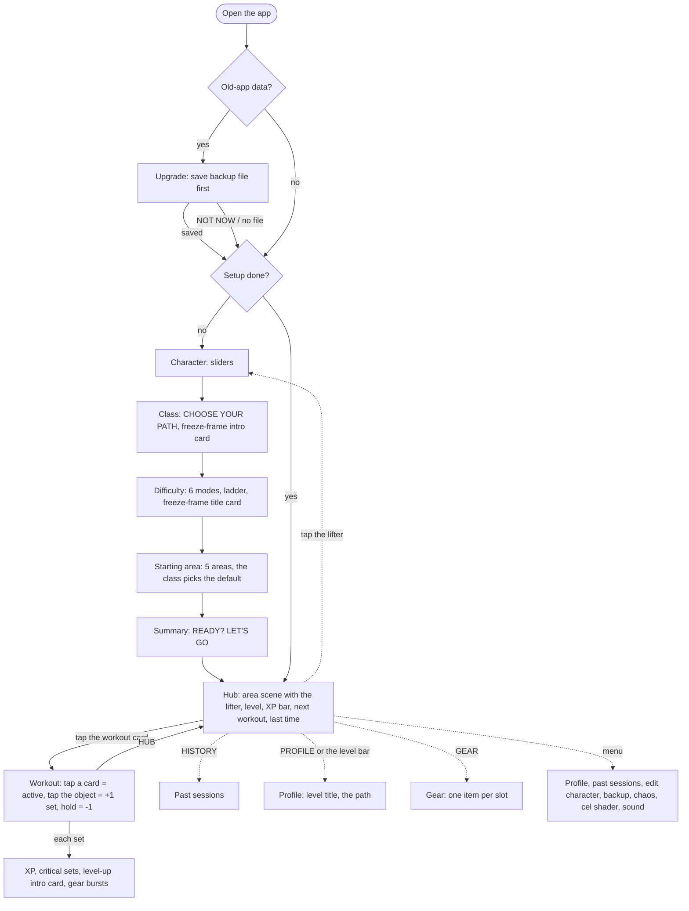

# PUMPLEX app flow

Date: 22 November 2026. Status: draft v9 (matches the code on `main`, with D32–D37).
Read with [decisions.md](decisions.md) (it wins), [app-brief.md](app-brief.md), [data-schema.md](data-schema.md),
`pumplex.drawio` and [docs/moodboard/](moodboard/README.md).

Status key: **exists** = in the app now. **later** = waits for the design team or the rules table.

## 1. Overview

The app has 3 parts:

1. **One-time upgrade** (only on a phone with old-app data): save a backup file, then turn the old
   sessions into XP and delete the old kg / reps data.
2. **Initial setup** (first launch): character, class, difficulty, starting area.
3. **Play** (any time): open the workout, count the working sets, get XP, unlock gear.

There is no calendar plan, no START TRAINING clock and no I WORKED button.
The user opens the app when they want, like a video game.

The whole app is **one screen**. Views are scenes of that screen. A change of view is a
camera move (zoom in, zoom out or slide), and the one character glides to its new place.
The app never pushes a new route for a view, so it never flashes a blank screen.

## 2. Screens (scenes)

| # | Scene | Status | Purpose |
|---|---|---|---|
| 0 | Upgrade | exists | Only with old-app data. SAVE BACKUP & UPGRADE, or NOT NOW. |
| 1 | Character | exists | WoW-style: the character large in the centre on a pedestal. Sex toggle, 🎲 random, sliders for height, muscle and fat %. Changes live. The sprite comes from the 5×5 body atlas. |
| 2 | Class select | exists | CHOOSE YOUR PATH: preview card (lifter, loadout, 3 tags), description, 4 class buttons, NEXT: DIFFICULTY. Freeze-frame intro card on each pick. |
| 3 | Difficulty | exists | 6 modes from the design board, Sofa to Nightmare Mode. A ladder with XP gems, no numbers. Freeze-frame title card on each pick. |
| 4 | Starting area | exists | 5 areas from the design board. Each card shows the area's scene art. The class picks the default area. |
| 5 | Summary | exists | Class, gear (equipment), difficulty, area. Tap a row to change it. LET'S GO (or SAVE when editing). |
| 6 | Hub | exists | Design demo 07: the area scene with the lifter in it (class outfit and equipped gear), level and XP bar, next workout card, last time, GEAR. Bottom bar: HISTORY, HUB, PROFILE. No streak card (D34). |
| 7 | Workout | exists | Design demo 08: exercise strip with the day's list and the area scene. No tools (D32). Tap a card to make it active. Tap the object = +1 set, hold = −1. Area marks stay in the world. |
| 8 | Reward | exists | XP on the active exercise line. CRITICAL SET message. Freeze-frame intro card for level-ups; bursts for new gear. No achievement burst (D35). Not a separate screen. |
| 9 | Past sessions | exists | Training days (sets per exercise against the target, time, class, area, XP) and old saves. |
| 10 | Gear | exists | Items per slot (head, top, bottom, shoes, weapon), with the gear icons. Locked items show their level. |
| 11 | Menu | exists | Full screen (design demo 12): YOU (profile, past sessions, edit character), GAINS INSURANCE (save / restore backup), LOOK AND FEEL (chaos mode, cel shader, sound). Opens from ⋮ on every view. |
| 12 | Profile | exists | Design demo 11: level and level title, XP bar, the path (class, difficulty, world; tap one to change it), PAST SESSIONS, GEAR. No milestones (D35). Opens from PROFILE or the level bar on the hub. Tap the lifter to change the body. |

Removed: the preloader, START TRAINING and its clock, I WORKED / I RESTED and UNDO,
the 7-day pattern, rest days, rest-day stats and the preview pages.
Removed on 22 Nov 2026: the workout tools SWAP, FIRST, SKIP, REMOVE and the ADD card (D32),
the streak and the hub's "This week" card (D34), and the achievements and milestones (D35).

## 3. Initial setup

Show it on the first launch. The body sliders open again from the hub (tap the character) and
the whole setup from the menu (EDIT CHARACTER).

1. **Character.**
   - Pick male or female. Sliders: height, muscle size, fat %. The user never types a weight or a height.
   - Sprites: the design team's 5×5 body atlas (`assets/body/body_atlas.png`, a copy of
     `docs/moodboard/creator/body_atlas.png`). Fat and muscle each have stops at 0/25/50/75/100,
     per sex. The app shows the nearest cell for in-between values.
   - The HEIGHT slider stretches the sprite vertically (owner decision D11).
     Nearest-neighbour scaling only. Gear never changes the body.
2. **Class select** (design: `docs/moodboard/README.md` "Class select").
   - Kicker `STEP 2 OF 5 · THE SWOLEMANCER'S PATHS`, title CHOOSE YOUR PATH, subline "What do you train with?".
   - Preview card: the user's lifter (from step 1), the class name in its colour, the loadout and
     3 tags. No stat table. The card's hard shadow takes the class colour. Then the description.
   - 4 class buttons (a radio group): name left, equipment right. One class per equipment type.
     Proposed names, kept in `lib/game/content.dart`. The ids are the design ids (D31) and never change:

     | Equipment | Class | Id | Colour |
     |---|---|---|---|
     | No equipment | Scrapper | `scrapper` | orange |
     | Basic home gym | Bargain Bruiser | `bruiser` | sky |
     | Lots of free weights | Plate Paladin | `paladin` | lime |
     | Lots of machines | Cablemancer | `cablemancer` | violet |

   - Each pick shows the **freeze-frame intro card** over the preview card: the lifter goes greyscale
     with high contrast, dark stripes cover the card, the class name slams in as a stencil tag
     (−6°, from 2.2× in 6 hard steps over 420 ms), the joke subtitle slides in on an ink strip (−3°).
     It closes after 1.8 s or on a tap. A new pick restarts it. Reduced motion: no slam or slide.
   - NEXT: DIFFICULTY.
   - The preview shows the body the user made in step 1, in the class outfit (D25).
3. **Difficulty** (design: `docs/moodboard/README.md` "Difficulty").
   - 6 modes, names in `lib/game/content.dart`: Sofa, Warm-up, Sweat, Pain, Brutal, Nightmare Mode (D28).
     Ids: `sofa`, `warmup`, `sweat`, `pain`, `brutal`, `nightmare`.
   - A vertical ladder, the hardest mode on top. Each rung has a diamond in its rarity colour and
     XP gems. The ladder shows no numbers.
   - A detail card: "DIFFICULTY n OF 6", who the mode is for, and the XP gems.
   - Each pick shows the freeze-frame title card over the detail card (the same card as in step 2).
   - The numbers per mode are in `lib/game/rules.dart`:

     | Mode | Exercises (D33) | Target sets | XP multiplier |
     |---|---|---|---|
     | Sofa | 3 | 2 | 1.0 |
     | Warm-up | 3 | 3 | 1.2 |
     | Sweat | 4 | 3 | 1.4 |
     | Pain | 5 | 4 | 1.6 |
     | Brutal | 6 | 4 | 1.8 |
     | Nightmare | 8 | 5 | 2.0 |

   - NEXT: STARTING AREA.
4. **Starting area** (design: `docs/moodboard/README.md` "Starting areas").
   - 5 areas. Each area has an object to hit, a set-mark style and a stamp for every 5th set:

     | Area | Id | Object | Set marks | Stamp | Default for |
     |---|---|---|---|---|---|
     | Riptide Shore | `riptide` | treasure chest | shells | PEARL! | — |
     | Gainsgard Keep | `gainsgard` | wall | tally marks | SLASHED! | Plate Paladin |
     | Rustbelt Flats | `rustbelt` | barrel | spray-painted Xs | TAGGED! | Scrapper |
     | Arcade Underpass | `arcade` | punch machine | tickets | COMBO! | Bargain Bruiser |
     | Frostbite Summit | `frostbite` | ice block | flags up a slope | SUMMIT! | Cablemancer |

   - The ids are the design ids (D36). The id is also the design's folder name in
     `assets/areas/` and the sound name. Old saved ids (`beach`, `castle`, `summit`) migrate once
     ([data-schema.md](data-schema.md) §5.3).
   - The class picks the default area until the user picks one. The user can choose any area.
   - Each area card shows a small copy of the area's scene art.
     The default area shows "YOUR PATH'S HOME".
   - The scenes are the design team's PNG layers (`assets/areas/<area id>/`). `tools/app/area_art.mjs`
     turns their `anim.json` files into `lib/game/area_art.dart`.
   - NEXT: READY?.
5. **Summary.** LET'S GO saves the profile. If old sessions were upgraded, the welcome burst shows their XP.

## 4. Play

### 4.1 Hub

Design: design demo `07-hub.html`.

- **Scene** (top): the area's scene with the lifter in it. The lifter wears the class outfit and
  the equipped gear. Tags show the area name and "class · difficulty". GEAR (top right) opens the gear.
- Tap the lifter to change the body sliders at any time. Each saved change is kept
  in a history (for charts later). In this edit, NEXT goes straight to the summary; tap a summary row
  to change the class, difficulty or area too.
- **Level and XP bar.** Tap it to open the profile.
- **Next workout card:** today's exercises, with tally marks for the sets done today, and
  TRAIN (or KEEP GOING after the first set). Tap the card: the camera zooms into the workout.
- **Last time:** the date and sets of the last training day.
- **Bottom bar:** HISTORY slides to the past sessions. PROFILE opens the profile.

### 4.2 Workout

Design: design demo `08-workout.html` and `docs/moodboard/README.md` "Workout screen", with the
owner's rules ([decisions.md](decisions.md)).

- A workout has a set number of exercises from the class exercise **pool**: 3 at the easiest
  difficulty, 8 at the hardest (§3). Each exercise has a **target** number of working sets from
  the difficulty. The pools are placeholders, all in `lib/game/content.dart`. The first exercise
  moves along the pool each day.
- **Header:** ◀ HUB, the class name and the area name.
- **Exercise strip:** one card per exercise of the day's list. Each card shows the name, the
  target slots as Xs (filled in rarity colours), +n for sets over the target, and a status: NOW,
  NEXT UP or CRUSHED. Tap a card to make it the active exercise.
- **No tools** (D32): no swap, no back to the first exercise, no skip, no remove, no add.
  The workout is the list the app picks for the day. To skip an exercise, do no sets on it.
- Old sessions (from before D32) can still hold removed, added or switched exercises.
  The strip and the hub do not show removed ones.
- **World scene:** the area's scene from the design PNG layers, with the lifter and the area's object.
  - TAP THE OBJECT: one working set of the active exercise.
  - HOLD THE OBJECT: take the last set back.
  - Each set plays the object's hit frames and shakes the scene in hard steps (320 ms). A starburst
    says "+1 SET", "CRUSHED!" at the target, or the area's stamp on every 5th set.
  - The marks stay in the world, in the area's mark style, in groups of five.
  - At the target, the strip moves to the next unfinished exercise after 0.8 s.
- **Over the sky:** the area's tap hint, and one line with the exercise, "SET n OF t" (or
  sets / target at the target) and the XP so far.
- **Tip:** on the first workout, until the first set, a tag says "Only working sets count".
- **Sound** (if SOUND is on in the menu): a set sound per area, a critical sound, a stamp on every
  5th set, a level-up horn, and a sound when a set is taken back.
- Reduced motion: no scene animation.
- ◀ HUB (or Android back) goes back to the hub.
- Not used from the design board: the I WORKED button, the running clock and "SESSION n"
  (owner decisions D6 and D7 in [decisions.md](decisions.md)). There is one session per calendar day (§4.4).
- Not used from the design board: the swipe and the tool row (D32 replaces D16).

### 4.3 XP, level, gear

The numbers come from [rules.md](rules.md) (draft v1). They are all in `lib/game/rules.dart`.

| Source | XP |
|---|---|
| Working set | 10 × difficulty multiplier (1.0 → 2.0, 6 modes). Sets above the target ×1.5, up to 2× the target; beyond that 0. |
| Critical set | 3% chance, ×2, "CRITICAL SET!!!". The roll is repeatable (seed: date, exercise, set number). |
| First set of the day | +50. |
| Legacy | 150 for each old-app workout day (beta). |
| Old streak bonus | No new streak XP (D34). The bonus that old sessions had is saved once as `streak` XP events. |
| Old achievements | No new achievement XP (D35). The saved `achievement` XP events stay. |

- Sets and first-set XP are computed from the sessions, so a rule change updates them.
  Legacy XP and the old streak and achievement XP are saved XP events.
- Level curve (Habitica): 25 × L for levels 1–4, 150 at level 5, then
  round((0.25 L² + 10 L + 139.75) / 10) × 10. Level 30 needs 660 (D19: the formula wins).
- A level-up shows the freeze-frame intro card ("LEVEL n" and a joke line).
- Each level can unlock gear items. A new item goes into its slot if the slot is empty. The user
  can equip one item per slot.
- Gear is the only unlock (by level). There are no achievements (D35).
- Not built yet (later in rules.md): mastery stars, the difficulty climb, character stats,
  bounties, gear drops with rarity, new game+. Embers are part of the streak, so they are gone (D34).
  The swap suggestion is on hold: the workout has no swap (D32).
- Each session stores the class, difficulty, area and exercise list it used, so its XP stays the
  same when the profile changes later (for example, after joining a gym).
- A class, difficulty or area change applies to today's workout only if it has no sets yet (the plan
  is made again). Otherwise today keeps its own, and the change shows from the next day.

### 4.4 The session rule (owner's decision: one session per calendar day)

There is no I WORKED button. The calendar day decides:

1. **One session per calendar day.** All set marks (and workout changes) on the same day belong to that day's session.
2. The session **opens** with the first mark or change of the day.
3. A later calendar day starts a new session. (A workout that goes past midnight becomes 2 sessions.)
4. A day with no working sets does not count: no XP, not in the history.

### 4.5 The streak (removed)

- There is no streak, no streak count and no week target (D34, 22 Nov 2026).
- The streak bonus that old sessions earned stays as saved XP ([data-schema.md](data-schema.md) §5.4).

## 5. History

- Training days, newest first: date, sets, time from the first to the last mark, class, area, XP,
  and "sets / target" with a tally per exercise. Today shows first, marked TODAY.
- Old saves (legacy sessions from the old app): date and time, if the old clock was used.
- Opens from HISTORY on the hub, PAST SESSIONS on the profile and in the menu. HUB goes back.

## 6. Special cases

| Case | What the app does |
|---|---|
| First launch with old-app data | The upgrade scene. SAVE BACKUP & UPGRADE opens Android's "Save as". Only if the file is saved: old workout days become legacy sessions with XP, then the old keys are deleted. Cancel or NOT NOW: nothing changes, the scene comes back on the next launch. |
| App closed during a workout | The marks are saved. Open the app the same day to continue. |
| Wrong mark | Hold the area's object in the workout scene. |
| Restore a backup | Replace all game data. Version 4 is the current file. A version-3 file loses its achievements list, and the app works out its old streak XP again. Old version-2 backups go through the same migration (legacy sessions + XP, no profile, so the setup runs again). Old-app keys on the phone are only deleted by the upgrade. Old class and area ids in the file become the design ids. |
| Saved data with old class or area ids | On launch, `speedy`, `rogue`, `warrior` and `mage` become `scrapper`, `bruiser`, `paladin` and `cablemancer` (D31), and `beach`, `castle` and `summit` become `riptide`, `gainsgard` and `frostbite` (D36), one time. The old text is kept first ([data-schema.md](data-schema.md) §5.2, §5.3). |
| First launch after the streak and achievements went (D34, D35) | One time: the old streak bonus of each session is saved as XP. The `achievements_v1` key is deleted. No one loses XP ([data-schema.md](data-schema.md) §5.4). |

## 7. Data

The saved data follows [data-schema.md](data-schema.md). The code is in `lib/game/model.dart`
(choices at the top of the file) and `lib/store.dart`.

| Key | Content |
|---|---|
| `profile_v1` | Profile + character (current values), `schemaVersion`, `createdAt`. |
| `body_history_v1` | Every saved slider change, with its time. |
| `sessions_v3` | Map date → session: class, difficulty, area, first and last mark, legacy, exercise list. |
| `xp_events_v1` | Saved XP events (legacy, and the old streak and achievement XP). |
| `gear_v1` | Owned item ids and slot → equipped item id. |
| `chaos`, `cel`, `sound` | Menu settings (true / false). SOUND is on by default. |
| `class_ids_v0_backup` | The profile and sessions text from before the class id migration (D31). |
| `area_ids_v0_backup` | The profile and sessions text from before the area id migration (D36). |
| `streak_xp_frozen_v1` | True once the old streak XP is saved as XP events (D34). |

The key `achievements_v1` (achievement id → unlock time) is deleted on start (D35).

The old keys `sessions_v2`, `logs_v2`, `swaps_v2`, `session_started_ms` and `snooze2_*` are
deleted by the one-time upgrade, after its backup file is saved.
