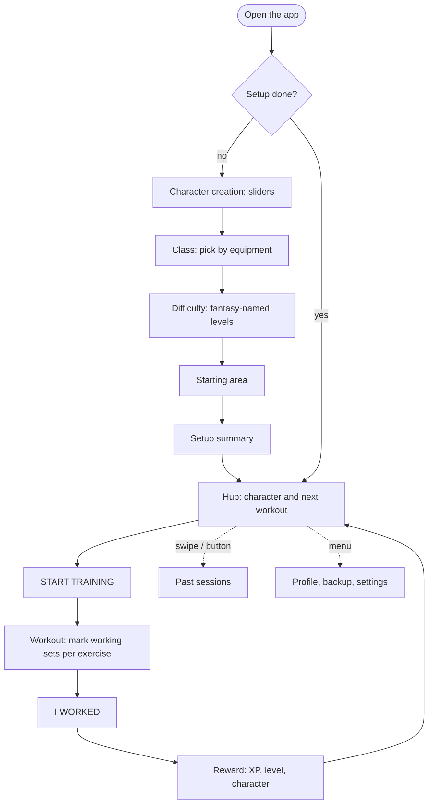

# PUMPLEX app flow

Date: 21 November 2026. Status: draft v2.
Read with [app-brief.md](app-brief.md), `pumplex.drawio` and `docs/moodboard/`.

Status key: **exists** = in the app now. **change** = in the app, must change. **new** = not built.

## 1. Overview

The app has 2 parts:

1. **Initial setup** (first launch only): character, class, difficulty, starting area.
2. **Play** (any time): pick up a workout, count the working sets, get the reward.

There is no calendar and no 7-day plan. The user opens the app when they want, like a video game.

## 2. Screens

| # | Screen | Status | Purpose |
|---|---|---|---|
| 1 | Preloader | exists | Short fake loader. Tap to skip. |
| 2 | Character creation | new | Sliders for height, muscle size and fat %. A 2D character changes live. |
| 3 | Class | new | Pick your equipment. Each equipment type is one class. |
| 4 | Difficulty | new | Pick one of many fantasy-named levels, beginner to expert. |
| 5 | Starting area | new | The world you train in. Sets the look, palette and set marks. |
| 6 | Setup summary | new | Shows the character, class, difficulty and area. "LET'S GO". |
| 7 | Hub | change | The character, the level and the next workout. Today this is the session page with a 7-day pattern. |
| 8 | Workout | new | The exercises. Mark the working sets for each one. |
| 9 | Reward | new | XP, level-up, character change. (The DAY DONE burst exists.) |
| 10 | Past sessions | exists | What you did and how long it took. Read-only. |
| 11 | Profile | new | Character, class, difficulty, level, XP to the next level. |
| 12 | Menu | exists | Backup, restore, chaos mode, cel shader (colleague's branch). |

Removed from the old flow: rest days, I RESTED, previews of the next days, the 7-day pattern.

## 3. Initial setup (new)

Show it on the first launch only. One screen, one choice, big buttons.

1. **Character creation.**
   - Pick male or female.
   - Sliders: height, muscle size, fat %. The pixel character changes as you move a slider
     (mood board: 3 × 3 fat × muscle sprites per sex; values in between need more frames).
   - The user never types a weight or a height.
2. **Class.** "What do you train with?"

   | Pick | Class (working name) |
   |---|---|
   | Nothing | Speedy class: cardio, push-ups, burpees, sprints, jumps |
   | A basic home gym | Rogue-like class: floor work, some cardio, some weights |
   | A lot of free weights | Warrior / paladin: burly strongman |
   | A lot of machines | Mage / assassin: stringy and strong |

3. **Difficulty.** A long list of levels with fantasy names (names come from the design work).
   Each level has a one-line description, from "never lifted" to "years of lifting".
4. **Starting area.** Comes from the mood board. Sets the background, the palette and the set-mark style.
5. **Setup summary.** Shows all 4 choices on one card. Press LET'S GO.

## 4. Play

### 4.1 Hub (change)

- The character (2D, with the cel-shaded look), the level and an XP bar.
- The next workout for the class: the exercise names only.
- START TRAINING ▶ (exists).
- No day numbers and no "rest day" pages.

### 4.2 Workout (new)

The main rule: count working sets, nothing else.

- One card per exercise, for example SQUATS and PUSH-UPS.
- Tap the card to add one working set. The mark depends on the starting area:
  - Beach: a shell drops into a pouch.
  - Castle: a scratch mark appears on a wall.
- Long-press to take one mark away (for a wrong tap).
- For weight exercises, count only working sets. A short hint says this on the first workout.
- The clock keeps running (exists). If the phone closes the app, the clock continues.
- I WORKED 💪 at the bottom (exists). A 6-second UNDO shows (exists).

### 4.3 Reward (new)

- XP for the working sets, times the difficulty.
- A level-up animation when you reach a new level.
- A character change, when the design has frames for it.
- Back to the Hub.

## 5. History (exists, change)

- Past sessions show the date, how long it took and (new) the sets per exercise.
- Today you swipe right on the session pager. In the Hub this becomes a "History" button or a swipe.

## 6. Special cases

| Case | What the app does |
|---|---|
| First launch with old data (sessions exist) | Run the initial setup one time. Turn the old sessions into XP (beta). |
| App closed during a workout | The clock and the marks are saved. Open the app to continue. |
| Wrong I WORKED | Tap UNDO in the 6-second message. |
| Wrong mark | Long-press the exercise card to take a mark away. |
| Restore a backup | Replace all data. Old backups (with the old sets) still load. |

## 7. Data the flow needs (for the schema document)

- Character: sex, height, muscle, fat % (slider values 0–100).
- Class: id (from the equipment pick).
- Difficulty: level id, XP multiplier.
- Starting area: id (palette, mark style).
- Session (exists): date, start time, end time.
- Set marks (new): per session, per exercise, the number of working sets.
- Progress: total XP, level. How to measure progress is still open.
