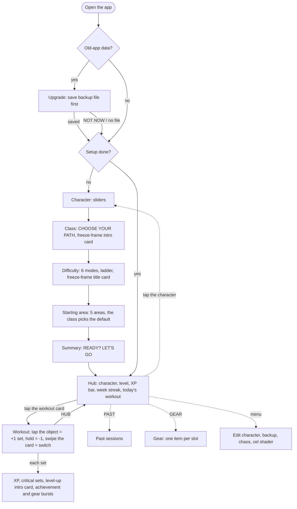

# PUMPLEX app flow

Date: 21 November 2026. Status: draft v7 (built on branch `claude/game-flow-2dbf96`).
Read with [app-brief.md](app-brief.md), `data-schema.md`, `pumplex.drawio` and `docs/moodboard/`.

Status key: **exists** = in the app now. **later** = waits for the design team or the rules table.

## 1. Overview

The app has 3 parts:

1. **One-time upgrade** (only on a phone with old-app data): save a backup file, then turn the old
   sessions into XP and delete the old kg / reps data.
2. **Initial setup** (first launch): character, class, difficulty, starting area.
3. **Play** (any time): open the workout, count the working sets, get XP, unlock gear.

There is no calendar plan, no START TRAINING clock and no I WORKED button.
The user opens the app when they want, like a video game.

The whole app is **one screen**. Views are scenes of that screen. A change of view is a
camera move (zoom in, zoom out or slide), and the one character glides to its new place.
The app never pushes a new route for a view, so it never flashes a blank screen.

## 2. Screens (scenes)

| # | Scene | Status | Purpose |
|---|---|---|---|
| 0 | Upgrade | exists | Only with old-app data. SAVE BACKUP & UPGRADE, or NOT NOW. |
| 1 | Character | exists | WoW-style: the character large in the centre on a pedestal. Sex toggle, 🎲 random, sliders for height, muscle and fat %. Changes live. The sprite comes from the 5×5 body atlas. |
| 2 | Class select | exists | CHOOSE YOUR PATH: preview card (lifter, loadout, 3 tags), description, 4 class buttons, NEXT: DIFFICULTY. Freeze-frame intro card on each pick. |
| 3 | Difficulty | exists | 6 modes from the design board, Sofa to Nightmare Mode. A ladder with XP gems, no numbers. Freeze-frame title card on each pick. |
| 4 | Starting area | exists | 5 areas from the design board. The class picks the default area. The scene swatches are placeholders. |
| 5 | Summary | exists | Class, gear (equipment), difficulty, area. Tap a row to change it. LET'S GO (or SAVE when editing). |
| 6 | Hub | exists | The character, equipped gear icons, level and XP bar, week streak, today's workout card. |
| 7 | Workout | exists | Exercise strip, the area's world scene and the active exercise card. Tap the object = +1 set, hold = −1. Swipe, add, remove, ↺. Area marks stay in the world. |
| 8 | Reward | exists | XP on each card. CRITICAL SET message. Freeze-frame intro card for level-ups; bursts for achievements and new gear. |
| 9 | Past sessions | exists | Training days (sets per exercise against the target, time, class, area, XP) and old saves. |
| 10 | Gear | exists | Items per slot (head, top, bottom, shoes, weapon). Locked items show their level. |
| 11 | Menu | exists | Full screen (design demo 12): YOU (profile, past sessions, edit character), GAINS INSURANCE (save / restore backup), LOOK AND FEEL (chaos mode, cel shader, sound: placeholder). Opens from ⋮ on every view. |
| 12 | Profile | exists | Design demo 11: level and level title, XP bar, the path (class, difficulty, world; tap one to change it), milestones (achievements), PAST SESSIONS, GEAR. Opens from ★ ME or the level bar on the hub. Tap the lifter to change the body. |

Removed: the preloader, START TRAINING and its clock, I WORKED / I RESTED and UNDO,
the 7-day pattern, rest days, rest-day stats and the preview pages.

## 3. Initial setup

Show it on the first launch. The body sliders open again from the hub (tap the character) and
the whole setup from the menu (EDIT CHARACTER).

1. **Character.**
   - Pick male or female. Sliders: height, muscle size, fat %. The user never types a weight or a height.
   - Sprites: the design team's 5×5 body atlas (`assets/body/body_atlas.png`, a copy of
     `docs/moodboard/creator/body_atlas.png`). Fat and muscle each have stops at 0/25/50/75/100,
     per sex. The app shows the nearest cell for in-between values.
   - The HEIGHT slider stretches the sprite vertically (owner decision D11).
     Nearest-neighbour scaling only. Gear never changes the body.
2. **Class select** (design: `docs/moodboard/README.md` "Class select").
   - Kicker `STEP 2 OF 5 · THE SWOLEMANCER'S PATHS`, title CHOOSE YOUR PATH, subline "What do you train with?".
   - Preview card: the user's lifter (from step 1), the class name in its colour, the loadout and
     3 tags. No stat table. The card's hard shadow takes the class colour. Then the description.
   - 4 class buttons (a radio group): name left, equipment right. One class per equipment type.
     Proposed names, kept in `lib/game/content.dart` (the ids stay the same):

     | Equipment | Class | Colour |
     |---|---|---|
     | No equipment | Scrapper | orange |
     | Basic home gym | Bargain Bruiser | sky |
     | Lots of free weights | Plate Paladin | lime |
     | Lots of machines | Cablemancer | violet |

   - Each pick shows the **freeze-frame intro card** over the preview card: the lifter goes greyscale
     with high contrast, dark stripes cover the card, the class name slams in as a stencil tag
     (−6°, from 2.2× in 6 hard steps over 420 ms), the joke subtitle slides in on an ink strip (−3°).
     It closes after 1.8 s or on a tap. A new pick restarts it. Reduced motion: no slam or slide.
   - NEXT: DIFFICULTY.
   - Note: the design shows a preview body per class; the app keeps the body the user made in step 1.
3. **Difficulty** (design: `docs/moodboard/README.md` "Difficulty").
   - 6 modes, names in `lib/game/content.dart`: Sofa, Warm-up, Sweat, Pain, Brutal, Nightmare Mode.
   - A vertical ladder, the hardest mode on top. Each rung has a diamond in its rarity colour and
     XP gems. The ladder shows no numbers.
   - A detail card: "DIFFICULTY n OF 6", who the mode is for, and the XP gems.
   - Each pick shows the freeze-frame title card over the detail card (the same card as in step 2).
   - The numbers per mode are in `lib/game/rules.dart`:

     | Mode | Exercises | Target sets | XP multiplier | Streak N (days per week) |
     |---|---|---|---|---|
     | Sofa | 3 | 2 | 1.0 | 2 |
     | Warm-up | 3 | 3 | 1.2 | 2 |
     | Sweat | 4 | 3 | 1.4 | 2 |
     | Pain | 5 | 4 | 1.6 | 3 |
     | Brutal | 6 | 4 | 1.8 | 3 |
     | Nightmare | 8 | 5 | 2.0 | 4 |

   - NEXT: STARTING AREA.
4. **Starting area** (design: `docs/moodboard/README.md` "Starting areas").
   - 5 areas. Each area has an object to hit, a set-mark style and a stamp for every 5th set:

     | Area | Object | Set marks | Stamp | Default for |
     |---|---|---|---|---|
     | Riptide Shore | treasure chest | shells | PEARL! | — |
     | Gainsgard Keep | wall | tally marks | SLASHED! | Plate Paladin |
     | Rustbelt Flats | barrel | spray-painted Xs | TAGGED! | Scrapper |
     | Arcade Underpass | punch machine | tickets | COMBO! | Bargain Bruiser |
     | Frostbite Summit | ice block | flags up a slope | SUMMIT! | Cablemancer |

   - The class picks the default area until the user picks one. The user can choose any area.
   - Each area card shows a scene swatch (dark sky, light floor, the object).
     The default area shows "YOUR PATH'S HOME".
   - The scenes and objects are placeholders (colours and emoji) until the pixel art exists.
   - NEXT: READY?.
5. **Summary.** LET'S GO saves the profile. If old sessions were upgraded, the welcome burst shows their XP.

## 4. Play

### 4.1 Hub

- The character, the class and difficulty name tag, the level and the XP bar.
- **Week streak:** boxes for this week's training days against the target N, and the run of streak weeks.
- Tap the character (or ✎ BODY) to change the body sliders at any time. Each saved change is kept
  in a history (for charts later). In this edit, NEXT goes straight to the summary; tap a summary row
  to change the class, difficulty or area too.
- Today's workout card: today's exercises, with tally marks for the sets done today.
  Tap the card: the camera zooms into the workout.
- ◀ PAST (top left) slides to the past sessions. ⚔ GEAR opens the gear. Equipped gear shows as icons.

### 4.2 Workout

Design: `docs/moodboard/README.md` "Workout screen", with the owner's rules (`docs/decisions.md`).

- A workout has a set number of exercises from the class exercise **pool**: 3 at the easiest
  difficulty, 8 at the hardest (§3). Each exercise has a **target** number of working sets from
  the difficulty. The pools are placeholders, all in `lib/game/content.dart`. The first exercise
  moves along the pool each day.
- **Header:** "TODAY'S WORKOUT · <AREA>" and ◀ HUB.
- **Exercise strip:** one card per exercise. Each card shows the name, the target slots as Xs
  (filled in rarity colours), +n for sets over the target, and a status: NOW, NEXT UP or CRUSHED.
  Tap a card to make it the active exercise.
- **World scene:** the area's scene with the lifter and the area's object.
  - TAP THE OBJECT: one working set of the active exercise.
  - HOLD THE OBJECT: take the last set back.
  - Each set shakes the scene in hard steps (320 ms). A starburst says "+1 SET", "CRUSHED!" at
    the target, or the area's stamp on every 5th set.
  - The marks stay in the world, in the area's mark style, in groups of five.
  - At the target, the strip moves to the next unfinished exercise after 0.8 s.
- **Active exercise card** (below the scene): sets / target and XP.
  - **Swipe** the card left or right: switch to the next or previous pool exercise that is not
    in the workout yet. **↺** returns a switched exercise to the one the workout first gave.
  - **✕** removes the exercise (kept in the session as removed).
  - Switch, ↺ and ✕ work only on an exercise with no sets (take the sets away first).
    Skipping = doing no sets.
- **+ ADD EXERCISE** adds an exercise from the rest of the pool.
- **Tips:** the area's tap hint and the XP per set. On the first workout a tip also says:
  working sets only, warm-up sets do not count.
- The scenes and objects are placeholders (colours and emoji) until the pixel art exists.
- Reduced motion: no shake and no bob.
- ◀ HUB (or Android back) goes back to the hub.
- Not used from the design board: the I WORKED button, the running clock and "SESSION n"
  (owner decisions D6 and D7 in `docs/decisions.md`). There is one session per calendar day (§4.4).

### 4.3 XP, level, gear, achievements

The numbers come from `docs/rules.md` (draft v1). They are all in `lib/game/rules.dart`.

| Source | XP |
|---|---|
| Working set | 10 × difficulty multiplier (1.0 → 2.0, 6 modes). Sets above the target ×1.5, up to 2× the target; beyond that 0. |
| Critical set | 3% chance, ×2, "CRITICAL SET!!!". The roll is repeatable (seed: date, exercise, set number). |
| Streak bonus | +5% set XP per streak week in a row (the weeks before this one), max +25%. |
| First set of the day | +50. |
| Achievements | The XP of the achievement, once (placeholder list in `content.dart`). |
| Legacy | 150 for each old-app workout day (beta). |

- Sets, first-set and streak XP are computed from the sessions, so a rule change updates them.
  Achievement and legacy XP are saved as XP events when they happen.
- Level curve (Habitica): 25 × L for levels 1–4, 150 at level 5, then
  round((0.25 L² + 10 L + 139.75) / 10) × 10. Note: rules.md lists 670 for level 30, but the
  formula gives 660; the app follows the formula.
- A level-up shows the freeze-frame intro card ("LEVEL n" and a joke line).
- Each level can unlock gear items. A new item goes into its slot if the slot is empty. The user
  can equip one item per slot.
- Not built yet (later in rules.md): embers, mastery stars, the swap suggestion, the difficulty
  climb, character stats, bounties, gear drops with rarity, new game+.
- Each session stores the class, difficulty, area and exercise list it used, so its XP stays the
  same when the profile changes later (for example, after joining a gym).
- A class, difficulty or area change applies to today's workout only if it has no sets yet (the plan
  is made again). Otherwise today keeps its own, and the change shows from the next day.

### 4.4 The session rule (owner's decision: one session per calendar day)

There is no I WORKED button. The calendar day decides:

1. **One session per calendar day.** All set marks (and workout changes) on the same day belong to that day's session.
2. The session **opens** with the first mark or change of the day.
3. A later calendar day starts a new session. (A workout that goes past midnight becomes 2 sessions.)
4. A day with no working sets does not count: no XP, no streak day, not in the history.

### 4.5 The streak

- The streak counts **training days per calendar week** (Monday to Sunday).
- A week with at least N training days is a streak week. N comes from the difficulty.
- Missing days inside a week never break it. A week below N ends the run of streak weeks.
- This week counts once it reaches N; until then the run from last week still shows.

## 5. History

- Training days, newest first: date, sets, time from the first to the last mark, class, area, XP,
  and "sets / target" with a tally per exercise. Today shows first, marked TODAY.
- Old saves (legacy sessions from the old app): date and time, if the old clock was used.

## 6. Special cases

| Case | What the app does |
|---|---|
| First launch with old-app data | The upgrade scene. SAVE BACKUP & UPGRADE opens Android's "Save as". Only if the file is saved: old workout days become legacy sessions with XP, then the old keys are deleted. Cancel or NOT NOW: nothing changes, the scene comes back on the next launch. |
| App closed during a workout | The marks are saved. Open the app the same day to continue. |
| Wrong mark | Hold the area's object in the workout scene. |
| Restore a backup | Replace all game data. Old version-2 backups go through the same migration (legacy sessions + XP, no profile, so the setup runs again). Old-app keys on the phone are only deleted by the upgrade. |

## 7. Data

The saved data follows `data-schema.md` (draft v1). The code is in `lib/game/model.dart`
(choices at the top of the file) and `lib/store.dart`.

| Key | Content |
|---|---|
| `profile_v1` | Profile + character (current values), `schemaVersion`, `createdAt`. |
| `body_history_v1` | Every saved slider change, with its time. |
| `sessions_v3` | Map date → session: class, difficulty, area, first and last mark, legacy, exercise list. |
| `xp_events_v1` | Saved XP events (achievement, legacy). |
| `achievements_v1` | Achievement id → unlock time. |
| `gear_v1` | Owned item ids and slot → equipped item id. |

The old keys `sessions_v2`, `logs_v2`, `swaps_v2`, `session_started_ms` and `snooze2_*` are
deleted by the one-time upgrade, after its backup file is saved.
